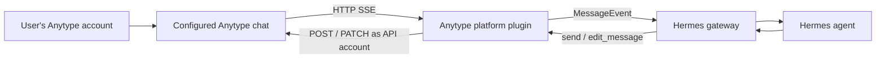

# Anytype v2 gateway for Hermes

Implementation contract: [SPEC.md](SPEC.md), with a combined [configuration example](hermes.example.yaml). The specification takes precedence over exploratory proposals in this report.

This report records the initial research. The implementation and subsequent MCP/test results are now described in [README.md](README.md) and [docs/VALIDATION.md](docs/VALIDATION.md).

Research date: 2026-09-24. Recommendation: implement a standalone Hermes **platform plugin** named `anytype`, using one outbound HTTP SSE subscription per configured chat and REST requests for replies. This fits the existing gateway without adding Anytype-specific code to Hermes core.

The intended deployment uses two Anytype accounts: the local API account is Hermes's sending identity; the user writes from another account in the same space. Sender access must be configurable as a member allowlist or anyone in the configured chats.

The first-version outbound chat format is `text` with inline markup, optional `attachments`, and optional `reply_to`. Do not generate a chat `blocks` field: the user confirmed that block-based chat messages are currently Desktop-only. Attachments are supported independently of that distinction. MCP-created objects can still contain structured document blocks; this restriction concerns the gateway's chat-message payload.

## Verified locally

| Check | Result |
| --- | --- |
| API address | `http://127.0.0.1:31009` |
| OpenAPI | `GET /docs/openapi.json` serves **Anytype API v2**; `info.version` is `2025-11-08`, despite the v2 routes |
| Authentication | Supplied bearer key accepted; scoped all-spaces grant, `readwrite` permission |
| Discovery | Two accessible spaces; the `Hermes` space contains a `General` chat |
| Chat history | `General` was empty at inspection |
| SSE | Authenticated stream returned HTTP 200, `Content-Type: text/event-stream`, and three `: keepalive` comments during a four-second probe |
| Hermes checkout | `aa8a33d22d27973df6591e48f38228274c8ad771`, dated 2026-09-24 |

The probe deliberately ended an otherwise open SSE connection; curl's timeout was expected. Only documentation and GET requests were used. No messages were posted, edited, deleted, or marked read. Message delivery and reconnect replay have therefore **not** been verified end to end.

The served specification is saved in [docs/anytype-openapi-v2.json](docs/anytype-openapi-v2.json), SHA-256 `135337fd3732155cf4bb55c66946f83c1b8bc7916c58cad4573b1564d5b4b1d9`. The supplied credential is not stored in this report or snapshot; the unmodified specification contains its own example key. v2 is explicitly pre-release, so this snapshot is a useful implementation baseline.

Additional behavior was checked against the adjacent `../anytype-heart` source. Its checked-out commit is `d99e1efca`; source findings below are not proof that the running binary has exactly that revision.

## API contract needed by the adapter

All authenticated calls use `Authorization: Bearer <key>`. v2 does not require the `Anytype-Version` request header.

| Purpose | Request | Relevant behavior |
| --- | --- | --- |
| Validate key grant | `GET /v2/auth/whoami` | Describes the key, not the sending person |
| Discover spaces | `GET /v2/spaces?ids=full` | Store full space IDs; compact references can become ambiguous |
| Discover chats | `GET /v2/spaces/{space}/chats` | Offset/limit pagination; rows have `id` and `name` |
| Identify bot account | `GET /v2/spaces/{space}/members/me` | Returns per-space participant `id`, account `identity`, name, and role |
| Resolve allowed users | `GET /v2/spaces/{space}/members` | Map account identities to participant IDs; paginate |
| Read history | `GET /v2/spaces/{space}/chats/{chat}/messages` | Returns `messages`, `state`, counts, `has_more`, and order cursors |
| Receive events | `GET /v2/spaces/{space}/chats/{chat}/messages/stream` | SSE; optional `Last-Event-ID`; `limit` 1–1000, default 25; `heartbeat` 1–60 seconds, default 30 |
| Send reply | `POST /v2/spaces/{space}/chats/{chat}/messages` | Body: `{"text":"...","reply_to":"<incoming message ID>"}`; response contains new `id` |
| Edit reply | `PATCH /v2/spaces/{space}/chats/{chat}/messages/{message}` | Body: `{"text":"..."}`; retains attachments and reply target |
| Upload attachment | `POST /v2/spaces/{space}/files` | Multipart `file`, or JSON URL; returned object ID goes into message `attachments` |
| Download attachment | `GET /v2/spaces/{space}/files/{file}/content` | Authenticated bytes; file/image IDs must not be treated as public URLs |
| Optional read receipt | `POST /v2/spaces/{space}/chats/{chat}/read` | For messages, requires `up_to` order ID and `last_state_id` from the same history read |

History pagination differs from SSE resumption: `after`/`before` are **message order IDs**; `Last-Event-ID` is a **chat state ID**. Neither is interchangeable with the message ID used for replies and edits. `after` alone pages forward with `next_after`; otherwise reads start at the newest end and page backward with `next_before`. Returned messages are ascending within each page. There is no individual-message GET in the inspected v2 specification; cache reply context or retrieve it through paginated history.

Chat text uses AnyBlock inline markup, not unrestricted Markdown. Send/edit requests accept up to 8,000 UTF-16 code units of parsed text. The first implementation must preserve supported object links while escaping ordinary text appropriately; escaping the entire reply as literal text would break the object-output workflow described below. Other formatting can be added incrementally. Python `len()` is insufficient for emoji. Attachments are object IDs, at most 32 per message. No typing-indicator or interactive-button route is present in this specification.

## How this fits Hermes



Use `BasePlatformAdapter` and register it through `register(ctx)` → `ctx.register_platform(name="anytype", ...)`. Required methods in the actual base class are `connect`, `disconnect`, `send`, and `get_chat_info`; implement `edit_message` for optional streamed responses. `send_typing` can retain its no-op behavior. Text approval and clarification fallbacks are available without buttons.

The closest small transport reference is **ntfy**, which already implements an async HTTP subscription, reconnect backoff, bearer authentication, and POST delivery. Its wire format is newline-delimited JSON, so its parser must be replaced with a real SSE parser. Telegram is the reference for inbound normalization, authorization before batching, reply context, UTF-16 chunking, and edited output. Copying the entire Telegram adapter would import many unrelated protocol concerns.

Additional adapters inspected after the initial research:

| Reference | Relevant implementation | What to carry into Anytype |
| --- | --- | --- |
| [Buzz](../hermes-agent/plugins/platforms/buzz/adapter.py) | `_load_cursors`, `_restore_channel_state`, `_seed_channel`, `_handle_events`; identity normalization and reply metadata | Persist per-chat resume state under the owning profile; bind it to the bot account and server; restore it on restart instead of treating outage arrivals as old history. Serialize atomic cursor writes so an older snapshot cannot overwrite a newer one. |
| [Matrix](../hermes-agent/plugins/platforms/matrix/adapter.py) | `_on_room_message`, `_resolve_message_context`, `_is_self_sender` | Account-based room ingress, own-message suppression, room selection, edit filtering, and mention gating. Anytype has its own participant identity and markup rules. Matrix's timestamp-based startup grace is not the model for Anytype replay handling; use Anytype state IDs. |
| [Discord](../hermes-agent/plugins/platforms/discord/adapter.py) | `_fetch_channel_context` and the inbound history-backfill block | When responding only to a prefix, mention, or reply, attach bounded recent group discussion to `MessageEvent.channel_context`. Keep it separate from the triggering user's text and from executable gateway commands. |
| [Email](../hermes-agent/plugins/platforms/email/adapter.py) | `_probe_imap(is_reconnect)` and `_seen_uids_snapshot` | Hermes can recreate an adapter during reconnect. State cannot live only on that instance. Email demonstrates same-process recovery; Anytype needs disk persistence too for process restarts. |
| [Raft](../hermes-agent/plugins/platforms/raft/adapter.py) | `_handle_wake`, child bridge lifecycle, no-op `send` | An alternative architecture: the adapter injects a wake hint, the bridge owns message cursors, and agent tools read/send messages. This is relevant to an MCP-driven design, but requires assigning message delivery and recovery to that tool/bridge layer explicitly. |

For the current design, combine ntfy's compact HTTP lifecycle, Buzz's persisted cursor structure, and Matrix/Telegram's inbound message handling. Discord's context backfill is a useful later addition for group use. The full Anytype adapter should continue to own `send()` so ordinary Hermes final replies, control-command responses, and scheduled delivery use the normal path. Raft's `internal=True` wake event represents its trusted bridge; an Anytype user's chat message must retain ordinary sender authorization.

Useful test references are [Buzz restart recovery](../hermes-agent/tests/gateway/test_buzz_adapter.py), [Buzz identity authorization](../hermes-agent/tests/gateway/test_buzz_authz.py), [ntfy plugin integration](../hermes-agent/tests/gateway/test_ntfy_plugin.py), and [Matrix media admission](../hermes-agent/tests/gateway/test_matrix_media_gate_before_download.py). In particular, test a newly constructed adapter after an outage, not just a reconnect loop on the existing object. These reference tests were inspected, not executed.

Recommended plugin files:

```text
plugin.yaml          # kind: platform; declares ANYTYPE_API_KEY secret
__init__.py          # lightweight register(ctx) entry point
adapter.py           # BasePlatformAdapter and registration
client.py            # REST requests, typed errors, SSE framing
state.py             # per-chat cursor, input deduplication, delivery state
formatting.py        # escaping, supported inline marks, UTF-16 splitting
tests/               # protocol and real Hermes integration tests
```

Use the current import paths: `gateway.platforms.event.MessageEvent` and `MessageType`, `gateway.platforms.base.BasePlatformAdapter` and `SendResult`, and `gateway.config.Platform`. Construct `Platform("anytype")` after registration; no enum modification is needed.

The planned Anytype MCP connection supplies a separate capability: agent tools for searching objects, creating tasks, and editing the space. Keep those tools in Hermes's existing MCP configuration, rather than registering duplicate object tools in the platform plugin. The gateway receives the user request, Hermes invokes MCP tools during the normal turn, and the gateway posts the result back to chat. Chat messages are separate from object document blocks in v2.

Both integrations can use the same bot account, with separately configured credentials if desired. MCP-originated edits to objects do not need to become chat prompts. If an MCP tool explicitly posts a chat message as the bot, the gateway's self-author filter also suppresses its echo. Ordinary user-visible replies should retain a single delivery owner: the gateway. Tools should not independently repost the same final answer.

Admission to chat and permission to use tools are separate configuration concerns. An admitted sender receives the capabilities of the selected Hermes profile; the platform allowlist does not by itself make MCP tools read-only for particular members. Keep MCP permissions/profile routing explicit when choosing the anyone mode.

The selected MCP is the official `@anyproto/anytype-mcp` Node package, launched locally as `npx -y @anyproto/anytype-mcp`. Hermes owns it as a **stdio subprocess**; a separate HTTP MCP listener is unnecessary. Its upstream README documents the default Anytype base URL as `http://127.0.0.1:31009`, configurable with `ANYTYPE_API_BASE_URL`. The MCP subprocess and gateway must both be able to reach that local Anytype instance; in a container, loopback refers to the container.

The user's `mcpServers` JSON block becomes a top-level `mcp_servers` section in Hermes YAML. [hermes-mcp.example.yaml](hermes-mcp.example.yaml) contains the matching configuration with `${ANYTYPE_API_KEY}` substituted by Hermes from the owning profile's secrets. Keep the supplied `Anytype-Version: 2025-11-08` header for wrapper/v1 compatibility; v2 does not require it. The example is not installed in an active profile.

The current upstream README documents v2-first OpenAPI discovery at `/v2/docs/openapi.json`, with fallback to `/docs/openapi.json` only on 404/410. A spec can also be selected explicitly with `run <spec-url>`. Discovery happens once per MCP process. It excludes event-stream tools because a stream cannot produce a bounded tool result, confirming that continuous chat ingress belongs in the gateway. These are upstream-documented capabilities; the npm subprocess has not yet been launched or its tools enumerated locally. At implementation time, verify discovery against the installed npm release and then pin the tested release for reproducible deployment.

Build each source with `self.build_source(...)`, then dispatch via `await self.handle_message(event)`. This preserves gateway authorization, profile routing, queued messages, `/stop`, approval replies, session state, and normal agent execution. Do not call `AIAgent` directly or await a complete model turn inside the SSE reader.

| Anytype field | Hermes field / handling |
| --- | --- |
| Full space ID + chat ID | Encode both in `source.chat_id`, e.g. `<full-space-id>/<chat-id>`; decode in every send path |
| Space ID | Also populate `source.scope_id` for context; it alone does not namespace a new platform's session keys |
| `message.author_id` | Canonical `source.user_id` |
| `message.author` | Display-only `source.user_name`; never an authorization key |
| `message.id` | `source.message_id` and `MessageEvent.message_id` |
| `message.text` | Event text, with any distinct `blocks_text` included as additional context |
| `message.at` | Parse RFC 3339 as an aware timestamp |
| `message.reply_to` | `reply_to_message_id`; resolve cached text/author when available |
| Space chat | `chat_type="group"`, `thread_id=None`; a reply anchor is not a new conversation thread |

The composite chat ID is important for outbound cron and `send_message`: those paths may only have the target string, without the original source metadata. Validate/decode it through the plugin target hooks. Implement `standalone_sender_fn` using the same REST client so delivery also works outside the gateway process.

## Structured results and links back to the space

Object links are a **first-version requirement**. A substantial research result should normally become an Anytype object through MCP, with a concise summary and a link posted in chat. When the result contains independently useful entries, the agent can create those as separate objects and group them in a collection. For example: a research report, individual source or comparison records, and follow-up tasks, linked through a research collection. Brief answers can stay in chat; an explicit request to keep the answer in chat takes precedence.

The agent decides the output structure using the available types, properties, and templates in the target space. MCP creates and edits the objects. The gateway renders the resulting links and sends the reply; it does not infer a database schema from free-form final text or duplicate the MCP object-creation tools.

The API supports two forms of reference:

1. **Inline links**, already supported by the chat text parser:

   ```text
   [Research report](anytype://object?objectId=OBJECT_ID&spaceId=FULL_SPACE_ID)
   ```

   Build the URL with a URL encoder from real IDs. Escape the title for inline markup separately from the URL. Full space IDs make the target explicit and portable across chat contexts. Preserve the link during formatting, chunking, retries, and final edits. These are Anytype app links, not localhost API URLs or public share links; readers need access to the target space.

2. **Native object attachments**: `attachments: ["OBJECT_ID", "COLLECTION_ID"]` in the chat POST body. Despite the field name, attachments are not limited to files: the server resolves each object in the chat's space and uses the `LINK` attachment kind for ordinary objects and collections. The cap is 32. For a large result set, attach/link the containing collection. The exact client presentation should be checked in live Desktop/mobile testing.

Deliver inline links through the existing `send(chat_id, content, ...)` interface, and support optional native object attachments alongside `text`. Collect only explicit, validated same-space references from the reply or deliberate adapter metadata. An inline cross-space link can retain its own space ID; an attachment cannot point outside the chat's space. Do not auto-attach every URL encountered in tool output. Attachments do not require a block-based chat body.

Example final API request body, using placeholders rather than real object IDs:

```json
{
  "text": "Research is ready. [Read the report](anytype://object?objectId=REPORT_ID&spaceId=FULL_SPACE_ID) or [browse the collection](anytype://object?objectId=COLLECTION_ID&spaceId=FULL_SPACE_ID).",
  "reply_to": "USER_MESSAGE_ID",
  "attachments": ["REPORT_ID", "COLLECTION_ID"]
}
```

`CreateResult.id` supplies the object/collection ID after a successful MCP call; the request's space supplies the space ID. A collection create accepts `name` and `items` (object IDs) and returns its own ID. Do not fabricate IDs or announce a saved report before creation succeeds. If some objects succeed and others fail, link the completed objects and describe what remains incomplete. Reuse confirmed IDs during recovery rather than creating the entire result again.

Agent guidance should be part of the configured profile/skill or stable platform hint: use native objects for substantial deliverables, reuse the space's schema, and return navigable links. Supply the current full space ID and chat ID through the existing per-turn context mechanism so MCP defaults to the conversation's space. Keep this routing context out of ad-hoc mutations to the conversation's cached system prompt.

Persist the final reply links with the normal delivery obligation so a transient chat-send failure does not lose access to already-created work. The same link renderer must be used by live replies and standalone cron delivery. A user sending or replying to an object link should also retain that reference in inbound text/context, allowing the agent to inspect the object through MCP on the next turn.

Deletion needs a precise distinction: the API's delete warning broadly names attached object IDs, but the inspected lower-level chat service explicitly garbage-collects orphaned **files** and leaves non-file orphan candidates alone. It does not establish that deleting a chat reply deletes an ordinary report or collection. Still, avoid automatic deletion of final result messages; for attachments, verify retention behavior in integration tests and keep durable generated files referenced from their result objects.

Verification should include a report link that opens from chat, a collection link, titles containing brackets/Unicode, native object attachments, links preserved through edit streaming and long-message splitting, inbound object references, and retrying chat delivery without recreating the objects. Link parsing and attachment classification were verified in source; no objects or chat messages were created during this research.

## Configurable users and conversation behavior

Proposed configuration, to be implemented by the plugin:

```yaml
gateway:
  group_sessions_per_user: true
  platforms:
    anytype:
      enabled: true
      group_allow_from:
        - "<your other account's identity or participant ID>"
      extra:
        base_url: http://127.0.0.1:31009
        chats:
          - space_id: "<full Hermes space ID>"
            chat_id: "<General chat ID>"
        trigger: all              # proposed: all | prefix | reply
        prefix: "!hermes"         # used in prefix mode
        startup_history: skip     # baseline existing history on first setup
        send_read_receipts: false
```

To admit anyone **in those configured chats**, replace `group_allow_from` with `["*"]`. Keep subscription targets explicit even though the current key grants all spaces. An empty allowlist should admit nobody. Put only `ANYTYPE_API_KEY` in the owning Hermes profile's secrets; URLs, targets, and behavioral settings belong in YAML.

Resolve configured account `identity` values through the member listing into the per-space participant IDs used by `message.author_id`. Accept participant IDs directly too. Keep session identity consistently keyed on participant ID; do not dynamically switch to an alternate ID after the member cache loads. Refresh member resolution for new members and reject unresolved identities until they can be verified. Never authorize by mutable display name.

Filter in this order: configured chat → ignore own API account (`members/me.id`) → member policy → trigger policy → normalized Hermes event. Ignoring the API account handles both SSE-before-POST-response races and replayed bot messages, regardless of the user allowlist. It also means manual messages from the bot's account are intentionally ignored, matching the two-account deployment.

Use Hermes's shared `group_allow_from` authorization path and register the plugin's allowlist hooks. Canonicalize identity-based configuration before it reaches the shared gate. The adapter must enforce explicit restrictions at intake too, so a broader global gateway grant does not defeat its chat/member selection. Verify both layers together: `group_policy: open` alone does **not** cause Hermes's current generic authorization code to admit everyone; the explicit wildcard allowlist expresses that choice.

`group_sessions_per_user: true` is Hermes's current default: each member has their own agent context within a group chat. Set it to `false` for one shared conversation per chat; this is a gateway-wide setting and affects other group platforms in the same profile. Authorization and session sharing are separate choices. Likewise, accepting anyone need not mean responding to every message: prefix/reply triggers can be added independently. Keep slash-command privilege controls (`group_allow_admin_from`, `group_user_allowed_commands`) separate from permission to chat.

## SSE and restart behavior

The stream opens with recent messages as `message_added`, followed by live events. A source-confirmed example shape is:

```text
id: <chat-state-id>
event: message_added
data: {"id":"<chat-state-id>","type":"message_added","message":{"id":"<message-id>","order":"<order-id>","author_id":"<participant-id>","text":"hello"}}

id: <opening-window-high-water-state-id>

: keepalive

```

The parser must process blank-line-delimited frames, multiline `data`, comments, and **id-only frames**. Some SSE helpers surface only dispatched events and silently lose the trailing id-only cursor. The example illustrates framing, not a captured message: the probed chat was empty.

Only `message_added` should trigger agent turns initially. Handle `message_updated`, `message_deleted`, `reactions_updated`, `state_updated`, and `pinned_updated` as cache/state updates; feeding edits back as prompts would retrigger on every streamed assistant edit.

On first setup, establish an explicit history baseline and retain it before processing new messages. A history read supplies the current state ID and newest order; subscribe with that state ID when present. An empty chat may have neither `messages` nor `last_state_id`, as observed here, and must work without either. Do not simply discard the first 25 events: that can discard live traffic in an empty chat. Distinguish first setup from a reconnect, where missed inputs should be recovered.

Persist the resume cursor per node/base URL, full space ID, and chat ID. Deduplicate inputs by chat and message ID. Store pending inputs before advancing the durable cursor: `handle_message()` schedules work, and `_gateway_accepted` is only a process-local admission receipt, not proof of a completed turn. A production implementation must reconcile pending input state with Hermes's session recovery and delivery ledger rather than claiming exactly-once execution.

Resume with `Last-Event-ID`. Only additions replay; edits, deletions, reactions, and pins do not advance the replay position. On `resync_required`, reconcile paginated history with stored message IDs, and report a gap that cannot be established. Absence of `resync_required` does not guarantee a complete history: out-of-order additions and reindexing can escape the window. A forward `after` scan is useful for normal catch-up but cannot prove it found late additions with older order IDs. Re-reading overlapping history or a full relevant range is needed for stronger reconciliation.

Use bounded buffering, reconnect backoff with jitter, and a read timeout longer than the heartbeat cadence. Close/cancel subscriptions on disconnect. The inspected Anytype source caps concurrent chat streams at 64 process-wide and drops slow consumers with `resync_required`; avoid subscribing to every chat automatically. Obtain Hermes's platform lock using the API account/node identity, not merely the key, because two different keys can address the same bot account.

## Sending and delivery limits

Return `SendResult(success=True, message_id=<API result id>)` after POST, and use `reply_to` to anchor the response to the incoming message. Reuse a stable `Idempotency-Key` for retries of the same logical send. Each changed PATCH body needs its own operation key. Persist operation identity so a retry does not generate a fresh key accidentally.

The inspected Anytype implementation stores idempotency receipts in a bounded, **in-memory** 1,024-entry cache. It does not promise durable deduplication across server restart or eviction. A timed-out committed POST is consequently ambiguous after such a restart; reconcile local delivery state and recent bot-authored replies before retrying. Do not promise exactly-once outbound delivery from that header alone.

Use final-message delivery for the first implementation. Incremental output can later use one POST followed by throttled PATCHes through Hermes's existing stream consumer. The inspected server defaults to **one sustained write per second with a burst of 60**, shared through its write limiter; a configuration can disable it. Do not assume Telegram's edit cadence is safe. Budget edits across all chats, coalesce updates, leave capacity for final sends, and handle HTTP 429 and any retry guidance. The numeric rate was inspected in source, not load-tested against the running service.

Override `message_len_fn` with Hermes's existing `utf16_len`, set an 8,000-unit cap, and split long output rather than truncate it. Include escaping and chunk suffixes in the budget; conservatively counting the serialized text is safe. Do not advertise code-block rendering until the chosen Anytype formatting conversion is verified. For media, reuse Hermes's download/cache and send hooks rather than passing authenticated API URLs to model tools.

## Implementation order and validation

1. Register/load the external plugin through real Hermes discovery; parse YAML and scoped secrets; validate the key, configured targets, and bot member identity.
2. Implement text ingress and final REST replies using `text`, optional object `attachments`, and `reply_to`, with preserved object/collection links, member allowlist/wildcard handling, bot echo suppression, explicit startup history policy, and persisted reconnection state. Do not emit a chat `blocks` field.
3. Exercise a real conversation from the second account, including `/new`, `/stop`, a clarification answer, and a restart with messages arriving during the outage.
4. Add throttled edit streaming, attachment upload/download, and standalone cron delivery using the same transport and target encoding.

Meaningful tests should cover SSE frames split across network reads, id-only cursors, an empty opening window, reconnection duplicates, resync reconciliation, self messages arriving before the POST response, allowed/disallowed members and wildcard admission, per-chat/per-user session isolation, long emoji output, timeouts/429s, and two Hermes profiles with different keys and policies. Integration tests should load the plugin through actual discovery under a temporary `HERMES_HOME`; in the Hermes checkout, use its prescribed `scripts/run_tests.sh` runner. No implementation or tests have been run yet.

## Source references

- [Official v2 introduction and SSE contract](https://developers.anytype.io/docs/reference/v2/anytype-api/).
- [Local served OpenAPI snapshot](docs/anytype-openapi-v2.json).
- [Hermes plugin adapter guide](../hermes-agent/gateway/platforms/ADDING_A_PLATFORM.md), [full guide](../hermes-agent/website/docs/developer-guide/adding-platform-adapters.md).
- [ntfy transport and registration](../hermes-agent/plugins/platforms/ntfy/adapter.py), [Telegram adapter](../hermes-agent/plugins/platforms/telegram/adapter.py).
- [Adapter base](../hermes-agent/gateway/platforms/base.py), [event types](../hermes-agent/gateway/platforms/event.py), [session keying](../hermes-agent/gateway/session.py), [authorization](../hermes-agent/gateway/authz_mixin.py), [platform registry](../hermes-agent/gateway/platform_registry.py).
- [Hermes MCP configuration and tool integration](../hermes-agent/website/docs/user-guide/features/mcp.md).
- [Hermes MCP variable interpolation and subprocess environment](../hermes-agent/tools/mcp_tool_config.py), [MCP config example](hermes-mcp.example.yaml).
- [Official Anytype MCP package, launch configuration, and API discovery behavior](https://github.com/anyproto/anytype-mcp#readme).
- [Anytype SSE framing](../anytype-heart/core/api/v2/handler/chat_stream.go), [replay and stream limits](../anytype-heart/core/api/v2/service/chat_stream.go), [event DTO](../anytype-heart/core/api/v2/model/chat_event.go), [chat DTO and identity mapping](../anytype-heart/core/api/v2/model/chat.go).
- [Anytype chat mutations](../anytype-heart/core/api/v2/service/chat.go), [idempotency implementation](../anytype-heart/core/api/v2/middleware.go), [write limiter configuration](../anytype-heart/core/api/server/router.go).
- [Anytype object-link parsing/space resolution](../anytype-heart/core/api/v2/service/spacelinks.go), [chat object-link tests](../anytype-heart/core/api/v2/service/spacelinks_test.go), [lower-level chat deletion and file cleanup](../anytype-heart/core/block/chats/service.go).
