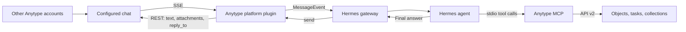

# Anytype gateway for Hermes — implementation specification

Version: 0.6.0 · 2026-11-10 · Target: stock Hermes ec324991

## 0.6 addendum: stock Hermes recovery

Ship without core patches. The original patched implementation is preserved at
`02555cd`. This addendum and the revised §7 supersede the earlier requirement for
per-input execution completion and exact-payload restart recovery. Keep history
catch-up, discovery, deduplication and the native tool-activity hooks unchanged.
Processing hooks manage activity only; they do not settle input receipts.

## 0.5.1 addendum: bundled workflow skill

Register `skills/anytype/SKILL.md` through `ctx.register_skill` as
`anytype-platform:anytype` and include it in the release archive. The platform
hint asks the agent to load it for research, task management or Anytype object work; retain essential space
and delivery rules in the hint. The read-only skill provides compact guidance
for MCP searches, research, tasks, parent context, links and scheduled jobs.
It does not configure MCP or automatically enter the system prompt skill index.

## 0.5 addendum: public tool hooks

Replace the generic activity callback patch with plugin registrations for
`pre_tool_call`, `post_tool_call`, and `post_llm_call`. Bind the publisher and
full space/chat target in the adapter's processing-start hook using a ContextVar;
Hermes copies it into agent and plugin workers. Hook callbacks only enqueue
observer work and return None; they never modify arguments, policy, or results.

Correlate by session/turn plus model request/call identity, generating fresh Heart
IDs per execution. Pre-tool labels say `Preparing <tool>` because approval and
policy checks may still be pending. Respect terminal outcomes including blocked,
cancelled and timeout, even without a start. Close unfinished rows on the final
turn hook and processing completion; reject late updates from closed bindings.
Exclude delegated child tools, muted diagnostic turns and unrelated CLI/cron work.

Route routine callbacks through the optional `send_or_update_status` adapter sink;
warnings use normal message delivery. Native typing stays unchanged. The release
package contains no core patches. Version 0.6 uses the stock recovery contract in §7.

## 0.4.1 addendum: native status instead of Working messages

Advertise Hermes's `supports_status_text` capability and consume its per-chat
`set_status_text` value through the existing typing refresh and Heart `/status`
publisher. Use a monotonic elapsed timer per full space/chat key; show elapsed
time in the fallback label after 30 seconds and reset it when typing ends.
Running structured tool executions retain priority and explicit terminal updates.
Native text is redacted and bounded through the same activity publisher.

Register the low display tier and explicitly configure
`display.platforms.anytype.long_running_notifications: false` in deployments with
global display overrides. This disables Hermes's separate 180-second message
timer. Native status remains independent of ordinary tool-progress messages.
No text matching in `send()` and no additional Hermes core patch are required.

## 0.4 addendum: discover accessible spaces at startup

`extra.discovery.spaces: all` lists all accessible spaces once per gateway connect,
using full IDs and complete pagination. Each space has its own member mapping,
snapshot readiness, chat/search subscriptions, recovery, and suspension. New grants
and spaces are picked up on restart; there is no periodic space-list poll or global
stream dependency. The existing `space_id` selector remains supported.

Preserve the account allowlist, pinned chats, home, and receipt namespaces. Scope
targets/sessions by full space plus chat IDs. Use origin delivery by default for
jobs outside the configured home's space. This adds transport coverage, not
per-collaborator restrictions on MCP, memory, or cross-space output. Current Heart
limits cap this mode at 16 spaces. See README for bootstrap and recovery semantics.

## 0.3 addendum: single-space multi-chat discovery

The optional `extra.discovery.space_id` enables Heart's space-wide chat stream
and creator-filtered search stream from `go-0000-search-stream`. The branch's
implemented contract supersedes earlier proposals for structured mention fields
and global resume cursors: parse canonical mention markup, reconcile complete
snapshots, and recover additions through bounded paginated REST history using
per-message creation `state_id` checkpoints. Never acknowledge counter snapshots.

Persist independent pinned, mention, and creator-based watches. Preserve the
first comment across search/chat ordering, revalidate precommit messages through
REST, and supply bounded parent context at admission. Discussion sessions use
Hermes thread settings; sends use the actual discussion chat ID and validated
matching thread metadata. The existing text, attachment, status, and durable
delivery contracts below remain in force. Automatic multi-space discovery and
worker isolation are not included. See [README.md](README.md) for configuration
and recovery limits, and [the implementation plan](docs/MULTICHAT_IMPLEMENTATION_PLAN.md)
for the reviewed design and checks.

## 0.2 addendum: ephemeral chat activity

Publish thinking and routine status as text-only updates to
`POST /v2/spaces/{space_id}/chats/{chat_id}/status`. Tool executions carry a
globally unique `data.tool_call_id`, tool name, compact argument metadata and
`in_progress`; refresh every two seconds. Each retry/new execution gets a new ID.
Complete the same row with `complete` or `error` and its JSON `result`, preserving
explicit null/false/zero/empty values. Repeat display text on every publication.
Serialize updates per execution so a heartbeat cannot follow a terminal update.
Cancellation and orderly shutdown attempt explicit error terminals for unfinished
executions; client timeout alone never synthesizes completion or failure.

Use the real ID-bearing Hermes tool callbacks, not tool-name correlation. Keep
the chat and run bound to each callback across parallel sessions. Ordinary status
and tool activity must not become messages or chat blocks. Warnings, approvals
and clarification stay on Hermes's existing delivery paths. Status failures are
nonfatal to message delivery. This lane is controlled by `extra.activity_status`.

The endpoint is ephemeral pubsub, not a durable transport. Bound and redact
payloads to fit Heart's 65,508-byte limit, honor server backoff, and report a final
publication that could not be confirmed. Do not reuse HTTP idempotency keys for
refreshes: each refresh must publish even though its tool execution ID stays fixed.

This specifies a standalone Hermes platform plugin, `anytype`, backed by Anytype API v2. The gateway receives chat events through HTTP Server-Sent Events (SSE) and posts ordinary Hermes replies through REST. The official local Anytype MCP server gives the agent tools for working with the space.

This document defines the intended behavior. See [README.md](README.md) for the implementation, stock Hermes compatibility and current limitations, and [docs/VALIDATION.md](docs/VALIDATION.md) for completed and pending checks. [RESEARCH.md](RESEARCH.md) contains the source investigation. This specification takes precedence over its exploratory proposals. [hermes.example.yaml](hermes.example.yaml) contains the combined configuration, with placeholders instead of credentials.

## 1. Product contract

The local Anytype API account is the bot. The operator and other participants write from different accounts in explicitly configured chats. The operator can admit particular account identities or space participant IDs, or anyone in those chats.

The first release must support this complete workflow:

1. A permitted participant asks a question in Anytype chat.
2. Hermes receives a normal gateway event with the correct sender, space, chat, and reply context.
3. Hermes answers directly, or uses MCP to inspect and modify the space.
4. Substantial deliverables become native objects, with collections when multiple independently useful objects belong together.
5. Hermes replies in chat with a concise result, links to the created objects, and optional native attachments.

**Outbound chat messages use `text`, optional `attachments`, and optional `reply_to`. They never contain `blocks`.** The text field supports Anytype's inline markup. The restriction on chat blocks does not apply to document blocks inside objects created through MCP.

### Release scope

| In 0.1 | Follow-up releases |
| --- | --- |
| External platform registration and profile-scoped configuration | Guided setup UI |
| Explicit chats; member allowlist and anyone mode | Per-chat policy overrides and native mention detection |
| All-message and literal-prefix triggers | Reply-only triggers and broader discussion backfill |
| Text input, reply context, and attached object references | Automatic binary attachment download and media transcription |
| Final text replies, object links, and native attachments using existing object IDs | File upload hooks and incremental PATCH streaming |
| Durable input receipts, reconnect/restart recovery, visible gap handling | Optional read receipts |
| Normal Hermes commands, text clarification and approval flows | Native buttons if the API gains support |
| MCP configuration and research/task/collection workflow | Object-change automation outside chat |
| Explicit-target standalone delivery through the same sender | Automatic home-channel selection |

Existing image/file object IDs are valid attachments in 0.1. Uploading local files and automatically downloading incoming binaries are separate follow-ups; an incoming attachment must still reach the agent as an object reference. Do not silently discard attachment-only messages.

## 2. Architecture and ownership



| Component | Owns |
| --- | --- |
| Platform plugin | Chat subscriptions, identity normalization, admission filtering, message rendering, sending, transport state |
| Hermes gateway | Sessions, model turns, busy-input behavior, commands, approvals, agent recovery, final delivery obligations |
| Anytype MCP | Searching, reading and modifying objects, properties, types, tasks, collections, and files through tools |
| Agent guidance | Choosing an appropriate result structure and returning links to confirmed results |

Use `BasePlatformAdapter`, `build_source()`, and `handle_message()`. Do not instantiate an agent directly. Register `Platform("anytype")` through `register(ctx)` and `ctx.register_platform(...)`; do not add Anytype branches to Hermes core.

Target an external plugin installed in the owning Hermes profile. Reuse scoped secret helpers and `get_hermes_home()`. Do not write process-wide environment variables to select a profile. Use the existing platform interfaces and the limited recovery contract in §7; do not introduce a core patch.

## 3. Configuration and identity

The canonical example is [hermes.example.yaml](hermes.example.yaml). Adapter settings live under `gateway.platforms.anytype.extra`; `enabled` remains a platform setting. These are proposed plugin keys, not an already available Hermes integration.

| Setting | Default / rule |
| --- | --- |
| `base_url` | `http://127.0.0.1:31009`; REST and SSE share it |
| `chats` | Required, nonempty list of full `space_id` + `chat_id` pairs; no automatic discovery subscription |
| `group_allow_from` | Empty means deny all; identities or participant IDs; `["*"]` admits anyone in configured chats |
| `group_allow_admin_from` | Explicit operator identities/participant IDs for Hermes slash-command privileges |
| `group_user_allowed_commands` | Example permits `new`, `stop`, `status`; Hermes also retains its read-only command floor |
| `trigger` | `all`; also accepts `prefix` |
| `prefix` | `!hermes`; required and nonempty in prefix mode |
| `startup_history` | `skip`; only supported initial-baseline policy in 0.1 |
| `attach_object_links` | `true`; attach validated same-space object links explicitly present in the final reply |
| `send_read_receipts` | `false`; reject `true` as unsupported in 0.1 |

Store `ANYTYPE_API_KEY` in the owning profile's secret store or `.env`; never in the plugin, examples, logs, or state database. Resolve it through Hermes's scoped secret helper. The example uses the same key for gateway and MCP; separately scoped keys are also possible.

At connection time, validate the key grant and each configured target. Fetch `/members/me` for each space to identify the bot's participant ID and account identity. `auth/whoami` identifies the key grant, not the person. Resolve configured account identities through paginated member listings; accept participant IDs directly after validating membership. Never authorize by display name.

Canonical sender IDs are per-space participant IDs, matching `message.author_id`. Normalize both chat and admin allowlists to that representation before invoking Hermes's shared gates. Refresh member resolution for unknown participants and on reconnect. An unresolved identity grants no access; a failed resolution must not become wildcard access. Suppress the bot's own messages regardless of allowlists, including messages manually sent from that account or posted through MCP.

Enforce configured chats and sender restrictions in the adapter, then retain Hermes's shared authorization checks. A broader global gateway grant must not widen the adapter's policy. Conversely, anyone mode must pass the real shared gate; `group_policy: open` alone is insufficient in the inspected Hermes version.

`group_sessions_per_user: true` is a top-level Hermes setting and the default: each participant has a separate session within each chat. Setting it to `false` shares one session per chat and affects other group platforms in that profile. This changes conversation context, not sender admission.

Slash-command privilege and chat admission remain separate. In current Hermes, omitting/emptying the admin list disables slash-command restrictions for that scope. The example therefore names an operator even in anyone mode. Admin status does not by itself grant chat access. Admitted participants receive the tool capabilities of the routed profile; the gateway allowlist is not per-user MCP authorization.

## 4. Inbound contract

### Target and message mapping

Use `<full-space-id>/<chat-id>` as Hermes's canonical chat target, including for scheduled and standalone sends. Validate both parts against the configured targets. Store full IDs; abbreviated space suffixes can become ambiguous.

| Anytype value | Hermes representation |
| --- | --- |
| Space + chat | Composite `source.chat_id`; space also in `source.scope_id` |
| `author_id` | Stable `source.user_id` and event sender ID |
| Author name | Display-only name |
| `id` | `message_id`; reply/edit identity |
| `order` | History cursor only |
| SSE frame `id` / state ID | Stream-resume cursor only |
| `text` | Triggering message text; preserve object links |
| `reply_to` | Reply anchor and bounded cached/history context when available |
| `attachments` | Object IDs with names/kinds when available, supplied as references for MCP |
| Timestamp | Aware RFC 3339 timestamp |
| Chat | `chat_type="group"`, `thread_id=None`; replies do not create threads |

Never change session identity when a member-name cache fills, and do not set `internal=True` on an external participant's message. Preserve original ingress IDs when Hermes merges, queues, or steers messages into an active turn.

The admission sequence is: configured target → self suppression → member policy → trigger/control handling → normal Hermes dispatch. In prefix mode, match the literal prefix at the start after leading whitespace, require a word boundary or end, and strip it once. An empty remainder is ignored unless attachments supply the request. Authorized slash commands and replies resolving an active Hermes clarification/approval must remain usable without the prefix, through existing control routing. Arbitrary history or attached-object text must not become a command.

Resolve replied-to messages from a bounded cache, then bounded history when necessary. There is no single-message GET in the inspected API. Missing/deleted targets must not prevent processing the new message; retain its original reference and identify unavailable context. Do not splice unrelated group history into the triggering user's text. If legacy `blocks_text` adds content absent from `text`, expose it as supplemental context without duplicating text.

### SSE lifecycle

Open one authenticated `GET /v2/spaces/{space}/chats/{chat}/messages/stream` per configured chat. No inbound webhook listener or public endpoint is required. Use `heartbeat=30`, an idle timeout above that cadence, and a bounded opening window. Maintain stream reading separately from model execution.

Implement actual SSE framing: incremental UTF-8 decoding, CRLF/LF boundaries, comments, multiline `data`, frames split across network reads, and **id-only frames**. The latter can carry the final opening-window cursor. Check frame/payload identity consistency and fail visibly on malformed message-bearing frames rather than advancing past unrecorded input.

| Event | Action |
| --- | --- |
| `message_added` | Deduplicate, persist admission outcome/input, then dispatch if eligible |
| `message_updated`, `message_deleted` | Refresh/invalidate cached context; never create a new model turn |
| `reactions_updated`, `state_updated`, `pinned_updated` | Update relevant state; never create a model turn |
| `resync_required` | Stop ordinary admission for that stream and reconcile history |
| Unknown event | Record diagnostic; do not interpret its contents as a prompt |

Use reconnect backoff with jitter, capped at 60 seconds, honoring server retry guidance. A slow-consumer/gap event also requires reconciliation, not just reconnecting. The inspected source limits streams to 64 process-wide; validate local target count and report server capacity refusal. Disconnect must close HTTP sessions and cancel readers/workers cleanly.

## 5. Chat output, links, and attachments

Initial output is final-message delivery. Disable incremental edits for this adapter even if another platform streams. Keep text control prompts available, with typing as a no-op. Configure interim assistant/tool progress output off for the example profile.

The send path returns `SendResult` with the confirmed API message ID. Use the incoming message ID as `reply_to` when Hermes supplies it. If a confirmed invalid/deleted reply anchor prevents posting, a deliberate fallback can retry without the anchor as a new logical request; a network timeout is not evidence of an invalid anchor.

```json
{
  "text": "Research is ready. [Read the report](anytype://object?objectId=REPORT_ID&spaceId=FULL_SPACE_ID).",
  "reply_to": "USER_MESSAGE_ID",
  "attachments": ["REPORT_ID"]
}
```

Send Hermes text as Markdown: the v2 API parses the inline subset (emphasis, code, links, mentions) into marks, and ordinary prose, stray specials and unsupported block syntax read literally. Ordinary prose, newlines, external links, and Anytype object links must work. Chunk at paragraph, then line, then whitespace boundaries, never inside a link, and size every chunk so its escaped form also fits. When the API rejects a chunk's markup (HTTP 400), persist and resend that chunk with the markup escaped into readable text under the same idempotency key. Do not advertise full Markdown/code-block rendering until verified on clients.

Build object links as `anytype://object?objectId=<encoded-id>&spaceId=<encoded-full-space-id>`. Escape the label separately from URL encoding. Never substitute localhost API URLs for navigable object links. Preserve explicit cross-space links, but attach only objects belonging to the chat's space.

For native attachments, combine deliberate attachment metadata with validated object links explicitly present in the final answer, deduplicate IDs in order, and cap the list at 32 per message. Do not attach every object found in tool output. Preserve inline links if an attachment cannot be resolved; a confirmed attachment validation failure may fall back to text-only with a distinct request identity. Never retry an ambiguous POST with a modified body. A large set of results should link/attach its collection.

Enforce the 8,000 UTF-16-unit text limit. Count conservatively after formatting, including any chunk labels. Split at paragraphs/words and do not split a link token; shorten an excessively long label or present its URL separately if necessary. Do not truncate results. Send chunks in order; anchor each to the original request, attach each object once to its associated chunk, and persist every chunk's delivery receipt so retries resume unsent chunks.

Use a node-wide write budget conservatively starting at one write/second, and handle 429/retry guidance. This matches the inspected server's sustained limit; MCP can consume the same server budget independently. Final replies must remain deliverable under throttling. Do not automatically delete result messages or their attachments as cleanup.

## 6. MCP and structured results

Hermes launches `npx -y @anyproto/anytype-mcp` as a local stdio subprocess using top-level `mcp_servers`, as shown in the example. Set `ANYTYPE_API_BASE_URL` explicitly and pass authorization through `OPENAPI_MCP_HEADERS`, interpolating `${ANYTYPE_API_KEY}` from the owning profile. Keep the supplied `Anytype-Version: 2025-11-08` header for wrapper compatibility; v2 itself does not require it.

Verify the installed npm package's tools and v2 discovery against the local server, then pin that tested release for deployment. The saved OpenAPI reports `2025-11-08` despite using `/v2` routes. Upstream documents v2-first discovery with fallback; this package has not yet been run locally. Stream endpoints are not MCP tools: continuous ingress remains the gateway's job.

Provide stable agent guidance with these rules:

- Use the conversation's full space ID as the default target; follow an explicit user request for another space when accessible.
- Inspect available types, properties and templates before choosing a structure. Reuse the space's conventions.
- Keep brief answers in chat. Save substantial research as an object; create separate records when individually useful and group them in a collection when appropriate. Honor requests to keep the answer entirely in chat.
- Create tasks with the space's task type and supported properties. Do not invent property IDs, dates, assignees, or task completion.
- Return a concise summary and links built from IDs confirmed by successful tool results. Mention partial failures and link successful work.
- Reuse confirmed object IDs when retrying delivery; do not recreate research because the chat POST failed.
- Let the gateway deliver the ordinary final answer. Do not also post that answer through an MCP chat tool.

Supply current space/chat context through Hermes's per-turn context facility, and stable general guidance through the platform hint or profile instructions. Do not rebuild cached system prompts mid-conversation. Inbound object links/attachments must preserve enough identity for MCP to inspect them on the next turn.

| Request | Expected result |
| --- | --- |
| “Research X” | Report object, concise chat summary, report link and optional attachment |
| “Compare these five options” | Comparison report; individual option records and a collection when useful |
| “Turn this into tasks” | Tasks with confirmed properties and links; collection if requested/useful |
| “Summarize this object” with an attachment/link | MCP reads that object; short answer in chat or saved summary as requested |
| “Update last week's report” | Find and update the existing report, then link it; avoid an unnecessary duplicate |

MCP unavailability must not prevent ordinary chat. Report that space operations failed rather than claiming something was saved. If only part of a multi-object workflow succeeds, retain its confirmed IDs and report the partial result.

## 7. Persistence and recovery

Use a small transactional store under the owning profile, such as `get_hermes_home()/anytype/state.sqlite3`. Namespace state by normalized API origin, bot account identity, full space ID, and chat ID. A changed token for the same account should retain state; a different bot account must not inherit it silently. Acquire the Hermes platform lock by node/account identity, not token string.

Store these concepts without duplicating Hermes's full transcript:

| Record | Minimum information |
| --- | --- |
| Chat checkpoint | Identity binding, first-setup baseline, last durable SSE state ID, history order boundary, health/gap state |
| Input receipt | Chat/message ID, admission outcome, pending payload, lifecycle state, Hermes correlation when available |
| Delivery operation | Stable logical ID, exact per-chunk payload/hash, idempotency key, confirmed remote ID, attempt/outcome |

Commit accepted input before advancing the durable stream cursor. An id-only cursor may advance only after all preceding message frames have been committed. Filtered/baseline messages need enough receipt/checkpoint information not to become fresh work on replay. Database failure pauses ingress; it must not advance only an in-memory cursor and continue.

### First setup versus restart

On first setup, read and persist a history baseline, then subscribe from its state ID where available. Existing messages are not prompts. An empty chat can omit both messages and state ID; after that empty baseline, accept subsequently observed additions. Never discard the first arbitrary number of stream events.

On restart/reconnect, restore the checkpoint rather than taking a new skip baseline. Resume using `Last-Event-ID`, deduplicate by chat/message ID, and recover pending inputs. History cursors use message **order** IDs; replies use message **IDs**; stream resumption uses **state** IDs. Treat all as opaque and distinct.

Reconcile history on reconnect and `resync_required`, scanning forward for normal downtime and overlapping earlier history to find late arrivals. Add periodic overlapping reconciliation while connected. Start with a 1,000-message overlap every five minutes; paginate further when the saved boundary is not covered, stopping at the initial baseline. Persist and expose `gap_unresolved` if limits, deletion, or changed history prevent establishing coverage. Do not silently reset the cursor and claim complete recovery. A finite overlap cannot guarantee discovery of arbitrarily old out-of-order additions; document that limit and provide an explicit deeper reconciliation operation.

Keep compact processed-ID receipts for the configured chat's lifetime; terminal payloads can be pruned separately. Bound pending work and memory; when capacity is reached, pause the stream and resume from the durable checkpoint through reconciliation rather than dropping inputs.

### Turn and delivery semantics

Persist `handing_off` before calling `handle_message()`, then `handed_off` on
normal return. This records a handoff attempt, not durable Hermes admission or
successful execution. It covers commands, merged inputs and queued inputs without
tracking Hermes's internal turn composition. Processing hooks manage activity only.
An interrupted/failed handoff becomes `uncertain` and is never independently
replayed. On restart, migrate legacy `dispatched`/`processing` to `uncertain` and
preserve terminal receipts and discovery checkpoints. A crash in the handoff gap
can lose a request before Hermes durably admits it; report uncertainty rather than
rerunning possible MCP side effects. Only never-handed-off pending inputs are retried.

For an anchored outgoing reply, persist each chunk's payload and idempotency key
and reuse them on immediate retries; skip chunks with a recorded API receipt.
A timeout or ambiguous POST must not trigger Hermes's immediate plain-text fallback.
Unanchored partial delivery must not silently resend the already-visible head.
Independent standalone calls get distinct operation IDs, even for identical text.

Hermes alone schedules delayed/restart recovery of final replies. Its stock ledger
preserves text, chat, thread and transport profile, but not the exact reply anchor,
explicit attachments or our operation ID. Its marked recovery is a new operation
and may duplicate a prior reply. Keep the old uncertain operation visible. Inline
object links survive and may produce previews again; explicit metadata-only
attachments may be absent. Do not claim exact-payload or exactly-once recovery.
Anytype's server idempotency cache is bounded and in memory.

## 8. Errors and operation

| Condition | Required behavior |
| --- | --- |
| Missing key, invalid config, unresolved configured target | Actionable startup error; no subscription to inferred targets |
| API offline / transient network failure | Reconnect with bounded backoff; retain pending state |
| 401/403 | Mark authentication/permission failure; stop rapid retries and expose the affected target |
| Chat removed or membership lost | Suspend that target; preserve state; keep unaffected targets working |
| 429 | Respect retry timing; reuse identity for immediate anchored retries, defer other recovery to Hermes |
| SSE parse/storage failure | Pause affected ingress; retain last durable checkpoint; expose failure |
| MCP unavailable | Continue plain chat; report failed object operations accurately |
| Ambiguous send or unreconciled input | Persist uncertainty and expose it for reconciliation |

Expose connected/reconnecting/auth_failed/gap_unresolved and pending/uncertain counts in logs/status using Hermes facilities where possible. Log short target references and operation IDs; redact authorization headers, keys and message bodies by default. No separate monitoring service is needed.

## 9. Implementation milestones

### M0 — prove Hermes integration seams

Load a minimal plugin through real discovery under a temporary Hermes home. Exercise configuration, canonical member IDs, allowlist/wildcard admission, slash privileges, sessions, and profile routing. Verify that secondary-profile secrets never fall back to another profile.

Validate the stock delivery and handoff contract in §7 using real Hermes adapter,
queue and ledger code with mocked HTTP. Cover merged/inline handoffs, interrupted
handoffs, state migration, anchored retries, unanchored partial sends and marked
boot/runtime recovery. Do not override global core functions or race an independent
outgoing retry loop against Hermes's delivery ledger.

### M1 — transport and admission

Implement REST/SSE client, config validation, bot/member lookup, transactional input checkpoints, baseline/reconnect handling, filtering and `MessageEvent` conversion. Demonstrate read-only ingress fixtures and real plugin authorization/session tests.

### M2 — complete chat loop

Implement final text sending, markup/link rendering, native attachments, chunking, reply anchors and persisted delivery operations using M0's verified contract. Reuse the sender for explicit-target cron/`send_message` delivery. Verify the second-account conversation, commands and control replies.

### M3 — MCP workflow and release checks

Run the local MCP wrapper, verify and pin its release, apply stable agent guidance, then exercise research → object/collection → chat links. Run restart, outage, partial-failure and client compatibility scenarios. Only after these pass, describe 0.1 as ready for daily use.

Suggested files: `plugin.yaml`, `__init__.py`, `adapter.py`, `client.py`, `state.py`, `formatting.py`, and `tests/`. Start with the smallest useful separation; reuse existing Hermes helpers for HTTP, UTF-16 length, profile scope and delivery.

## 10. Acceptance criteria

| Area | Passing evidence |
| --- | --- |
| Plugin integration | Real discovery/config loading; no Anytype-specific core registration edits |
| Authorization | Listed identity and participant ID admitted; outsider denied; wildcard works; self always ignored; global grants cannot widen local restrictions |
| Privileges | Non-admin cannot run restricted commands; authorized control replies and `/stop` work in prefix mode |
| Session scope | Two users/two chats do not collide by default; shared-session setting behaves as documented; profile A → B → A retains separate secrets/state |
| SSE | Fragmented frames, UTF-8 boundaries, id-only cursor, empty chat and duplicate replay handled; non-add events never start turns |
| Startup/restart | Historical first-setup messages skipped; first new message retained; messages during downtime recovered after adapter recreation and process restart |
| Recovery | Receipt/cursor/handoff crash boundaries tested; merged and inline inputs retain handoff receipts; stock marked redelivery tested; gaps and uncertainty visible; no plugin rerun of uncertain side effects |
| Chat payload | Every create body uses `text` and optional `attachments`/`reply_to`, never `blocks` |
| Formatting | Emoji beyond BMP, escaped titles/brackets, long replies, object/collection links and chunk boundaries work without truncation |
| Attachments | Same-space ordinary object, collection and existing file/image IDs accepted; cross-space links retained without invalid attachments; attachment-only input preserved |
| Delivery | Retry retains operation/key/body; partial chunk delivery resumes correctly; restart retains reply anchor and attachments; ambiguous server-restart case is surfaced |
| MCP | Correct local v2 tools listed; report and collection created; chat links open; retrying only delivery creates no new objects |
| Client behavior | Text, links, replies and attachments checked on Desktop and a mobile client; no dependency on desktop-only chat blocks |
| Lifecycle | Offline/429/auth loss handled; clean disconnect; no orphan stream tasks or duplicate subscription owner |

Use protocol fixtures/fake HTTP responses for boundary cases and real Hermes imports/discovery under temporary homes for integration checks. Follow the Hermes checkout's `scripts/run_tests.sh` runner. Live write tests use a dedicated test chat and explicitly tracked test objects; do not bulk-delete attachments as cleanup.

Original research baseline: local API documentation/auth/discovery and heartbeat-only SSE were verified read-only. Implementation and validation have since progressed; [docs/VALIDATION.md](docs/VALIDATION.md) tracks the current evidence. The next release gate is live acceptance with the second account.
