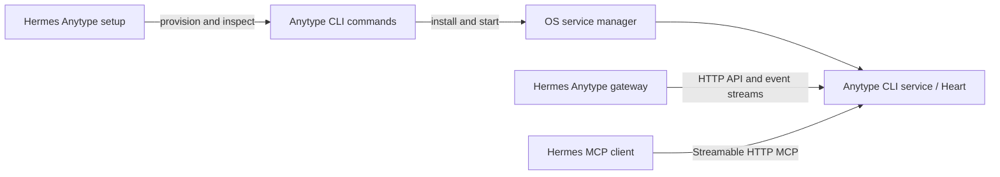

# Anytype–Hermes onboarding, setup and CLI specification

Date: 2026-10-09 · Status: design and acceptance specification · Implementation baseline: gateway 0.5.1

Implementation update: standalone native provisioning now targets CLI `a9c6567`
on `go-7383-full-wrapper`. [SETUP.md](SETUP.md) documents the exact supported
schema, choices, default-instance limitations and resume behavior. The proposed
sections below retain the design rationale; platform-menu registration and live
acceptance remain separate prerequisites.

This specification defines a guided installation for a dedicated Anytype bot,
connection to an existing desktop client, and ongoing operator commands. It does
not implement these flows or change existing installations. Commands and fields
marked **proposed** are contracts to implement, not currently available interfaces.

## 1. Decisions

- Recommend **Anytype CLI** for a new unattended bot. Keep **existing Anytype
  desktop client** as a first-class connection choice. Preserve the backend of
  existing installations when they upgrade.
- Hermes owns the setup experience and its profile configuration. Anytype CLI
  owns its account, data, network configuration, synchronization and service
  definition. The OS supervises that service.
- Keep one Anytype gateway transport. Both backends expose the same required
  Heart HTTP API; backend selection changes provisioning and connection settings.
- Ask for the bot's visible Anytype name when creating its account. Preserve the
  name of an existing account unless the operator explicitly chooses to change it.
- Use the CLI's planned built-in **Streamable HTTP MCP** when available. Retain
  the current Node MCP wrapper for compatible installations without that server.
- Use public Hermes registration and configuration interfaces. This work adds no
  core patch and does not change the existing recovery-patch dependency.

## 2. Existing capabilities and work required

| Area | Available evidence | Required work |
| --- | --- | --- |
| Hermes setup | Platform registration accepts `setup_fn`, but the inspected `hermes setup gateway` caller overwrites callback-written config and may start the service automatically. | Ship the standalone plugin wizard first; gate menu integration on a corrected public host contract. |
| Plugin CLI | `hermes anytype status` and `reconcile --deep` exist. | Add setup, connection diagnostics and space-join workflows. |
| Anytype CLI | Public source provides named account creation (`anytype auth create <name>`), login, invitation joining, API-key creation and service commands. | Verify the selected release; add the automation contract in §9. Existing-account rename needs separate capability verification. |
| Gateway | API v2, chat/discussion discovery, activity, allowlists, home delivery and startup space listing exist. | Add capability-aware setup and useful readiness diagnostics. |
| MCP | Hermes supports stdio and HTTP MCP; our example uses the Node wrapper. | Configure and validate the planned CLI HTTP MCP endpoint. |

Anytype CLI's built-in MCP server is a planned capability supplied by the next
CLI version, not a feature verified in the installed gateway. Its endpoint and
authentication contract must be reported by the CLI rather than guessed.

## 3. Ownership and runtime behavior



The diagram shows CLI mode. Desktop mode connects the same gateway to Heart in
the running desktop app; MCP uses whichever supported endpoint or wrapper that
installation provides.

| Owner | Responsibilities |
| --- | --- |
| Setup wizard | Select/reuse a backend, run setup operations, obtain integration credentials, configure Hermes, verify readiness. |
| Anytype CLI | Account lifecycle, credential storage for the bot account, local data, service configuration and updates. |
| OS supervisor | Run the installed Anytype service according to the CLI's supported platform behavior. |
| Gateway | Connect, subscribe, route messages, publish activity, reconnect and report unavailable dependencies. |
| Hermes MCP client | Discover and invoke the configured Anytype tools. |

Setup invokes the CLI's service commands rather than writing its own launchd or
systemd definitions. Gateway startup, plugin import, registration, status probes
and dependency checks must not install software, create accounts or switch the
CLI's logged-in account. Stopping Hermes leaves Anytype running. Removing the
plugin leaves Anytype's service, account and data intact.

At boot, a temporarily unavailable backend produces a retryable connecting state.
Invalid credentials, incompatible capabilities and account mismatches produce
specific actionable states instead of repeated account creation or login attempts.
MCP readiness and gateway readiness are reported separately.

## 4. Entry points and connection choices

After installing and enabling the plugin, the supported entry is **proposed**
`hermes anytype setup`, registered through the public plugin CLI interface.

Defer `register_platform(setup_fn=...)` integration on the inspected Hermes
baseline. `hermes setup gateway` and full setup can save their pre-callback config
snapshot afterward and start a stopped gateway without asking. Merely recommending
`hermes gateway setup` does not protect the same callback from those other callers.
Add menu integration only at a verified Hermes version whose public setup contract
preserves plugin configuration and the operator's activation choice. Do not patch
core, inspect private caller stacks or register a provisioning callback prematurely.

The setup entry point must be discoverable before an API key exists. Do not make
the user supply the very key that the wizard is intended to generate. Review
manifest credential prompting and connection checks for this bootstrap case;
normal gateway connection still requires valid credentials.

The existing `register_cli_command(..., setup_fn=...)` argument configures an
argument parser. It is distinct from the platform's interactive setup callback.

| Choice | Initial behavior |
| --- | --- |
| Headless CLI — default for a new setup | Detect an existing CLI/service and account. Offer reuse before provisioning a new one. |
| Existing desktop client | Ask for the API origin and application API key; the app owns account login and space joining. |
| Existing externally managed CLI service | Attach to its API/MCP endpoints; leave container/service provisioning to its operator. |

Default API origins are `http://127.0.0.1:31012` for CLI and
`http://127.0.0.1:31009` for desktop. Custom origins are supported through the
existing `base_url` setting. An existing explicit origin always takes precedence.
The URL must be reachable from the Hermes process; in a container, localhost
refers to that container.

An existing CLI service may serve other clients. Setup must not replace its
identity, change its ports, log it out or reinstall it just because a Hermes
profile is new. Distinct bot instances require explicit CLI support for separate
configuration, data, service identifiers and all listening ports. Until that
contract exists, offer reuse or an externally provisioned instance rather than
claiming automatic per-profile isolation. Preserve the gateway's existing
account-ownership lock; shared MCP access does not authorize duplicate gateway
consumers of the same bot account.

## 5. Interactive onboarding

### 5.1 Inspect and select

Load the active Hermes profile and any prior setup record. Detect the configured
connection, CLI executable/version, service state and account identity without
mutating them. Offer **keep existing**, **repair connection** or **change
connection** for an existing setup. New setup defaults to CLI mode.

For a new CLI installation, use a supported release from the official distribution
and verify it through the distribution's integrity mechanism when available.
Version checks alone are insufficient: the embedded Heart must expose the
capabilities used by this gateway. Setup never silently upgrades a shared service.

### 5.2 Prepare the CLI and account

1. Reuse an existing service, or offer installation/start through the CLI. Support
   an externally managed service without taking ownership of it.
2. For account creation/login, choose the Anytype network or a self-hosted network
   configuration before creating account data. Existing accounts keep their
   network configuration.
3. Offer **use this account**, **log in with a bot account key**, or **create a bot
   account**, showing the known identity and name. Existing-account reuse is the
   default when one is already logged in.
4. For a new account, ask **What should people call your agent?**, suggesting
   `Hermes`. Pass the chosen display name to the CLI's account-create operation.
   Reused/imported accounts keep their current name by default; show it after login.
5. Let the CLI store the account credential. For a new account, present its
   recovery credential through the CLI's intended private setup interface.

The service may start before login, but HTTP API readiness is checked after an
account is available. Do not treat a pre-login unavailable API as proof that the
service installation failed.

Changing an already-used bot account is a separate migration operation, not an
automatic repair. It can change visible authorship, creator-based watches and
transport state; v1 setup must stop and explain that distinction.

#### Agent name

This is the Anytype account's public display name, visible to other space members.
It applies to that account across spaces and clients, not just this Hermes profile.
It does not rename the Hermes profile, change the model's persona, or create a
per-space alias. Account identity remains the authorization and mention target;
matching a display name must never grant access or enroll a chat.

For creation, trim surrounding whitespace, reject an empty name or control
characters, preserve Unicode and internal spaces, and apply the CLI/server's
reported limits. Non-interactive creation requires an explicit `agent_name` in
the proposed setup input; interactive setup may accept the displayed `Hermes`
default. Invoke the CLI with argument arrays, never shell interpolation.

The inspected CLI supports naming at creation. An existing-account rename command
has not been verified. Offer **change agent name** only if the selected backend
reports a supported profile-update operation; otherwise show the current name
and direct the operator to a supported client flow if available. Never create a
replacement account to change its name. A shared service's name is not silently
changed for a new Hermes profile.

An explicit rename records the expected account identity and requested name,
then reads the profile back to verify the result. On interruption, reconcile the
current identity/name before retrying; do not overwrite a conflicting external
change automatically. A local update can succeed before remote members see it
through sync. Record desired and observed names as setup metadata, not as a new
gateway identity field. A rename preserves keys and their stable application
names, receipts, watches, allowlists and the selected home chat.

### 5.3 Join or select a space

Show already accessible spaces and offer an invitation-link input. For CLI mode,
pass the link to the CLI's join operation. Desktop mode asks the user to join in
the app, then refreshes the accessible-space list.

Distinguish **request submitted**, **awaiting approval**, **joined/syncing**,
**usable**, and **rejected/expired**. Track membership and space IDs through the
CLI's native inspection contract before an API key exists. A successful join
command is not proof of usable membership. Wait with visible progress or let the
user exit and resume; do not continually resubmit the invitation. Confirm
**usable** through authenticated HTTP checks after §5.4, when the expected account
can read the space and enumerate the required chat/member surfaces.

### 5.4 Choose space scope and obtain credentials

Offer fixed single-space discovery or all spaces accessible to the bot's API
grant. Recommend all accessible spaces for a dedicated bot, explaining that a
grant including future spaces will cover later joins too. Select scope from the
native space IDs/membership state; do not require HTTP member/chat inspection yet.

Create the candidate integration API key through the CLI after scope is known.
Desktop/external mode accepts a key obtained through that backend's supported
flow. Reuse a matching valid credential where available. Validate bot identity,
space access and required write capability with the candidate, then confirm usable
membership. Gateway replies and activity need write access even if some agent
tools are configured read-only. Keep candidate secrets separate from live ones
until the publication step in §6.

### 5.5 Choose policy, home and MCP

Using the validated candidate connection, ask the user to select their other
account from confirmed membership information or supply its Anytype identity.
The invitation's creator is not automatically the Hermes operator. Do not infer
permission from display names.

- Default sender access to the selected operator account identity. Anyone mode
  is an explicit alternative; keep administrator identities explicit in either
  mode. An unresolved identity does not become unrestricted access.
- Preserve mention-based enrollment and creator-based discussion watches.
  `response: all` means authorized messages in watched chats, not all messages
  everywhere in every space.
- Offer an existing home chat, **create Hermes Home**, or skip the home. Creating
  the chat is an explicit setup choice, performed after credential/capability
  validation and recorded for resume. Pin the chosen home alongside its full
  space ID.
- Explain scheduled delivery: `deliver="anytype"` resolves to the configured
  home; jobs in another space should use their origin unless another destination
  was requested. This is agent guidance, not a rewrite of existing jobs.

Preserve existing group/thread session settings and platform overrides. For a
fresh profile, use the documented gateway defaults. Do not silently change
Hermes-wide settings that also affect other configured platforms.

The sender allowlist controls who can invoke the agent. It does not implement
the future collaborator-specific filtering of MCP searches, memory or outputs.

Offer MCP connection as part of the same wizard, while allowing chat-only setup.
Prefer built-in HTTP MCP when the chosen backend reports it; otherwise offer the
existing Node wrapper explicitly. Keep the logical MCP server name `anytype`.
If that name already belongs to another account/scope, block candidate activation
until the conflict is resolved. **Keep existing** retains the prior connection and
does not activate the incompatible candidate. Alternatives are explicit replacement,
explicit removal/disablement of the mismatched MCP server for chat-only use, or a
separate Hermes profile. Chat-only never means leaving mismatched tools enabled.
Do not merge incompatible transports.

### 5.6 Validate, save and activate

Validate the candidate connection before replacing a working configuration.
Checks include:

- Account identity and requested API grant; full space/member/chat identifiers.
- The API v2 message/history surfaces and the selected mode's message streams,
  chat subscription and creator-search subscription.
- Discussion parent context and the `/chats/{chatId}/status` capability when
  enabled. Report a missing optional activity endpoint separately from chat
  failure; do not silently claim it is working.
- HTTP MCP initialization and tool discovery, or wrapper startup and discovery.
  Check the tools needed for the bundled skill rather than assuming transport
  success means searches and object operations are available.
- Home membership, identity allowlists, and current stream/space limits. The
  tested Heart build has a 16-space discovery limit; report the negotiated or
  known version-specific limit instead of treating it as universal.

Use reported capabilities/schema plus read-only probes. Do not test compatibility
by creating dummy objects or sending unsolicited messages. A final **send test
message** action is available when the user chooses it.

Merge only the Anytype-owned settings and secret references into the active
profile. Reuse Hermes's config/secret helpers, detect intervening edits and publish
the validated candidate through the staged-secret protocol in §6. A setup journal
or an enable-last flag alone cannot protect an already-enabled connection from
partially replaced credentials. Preserve unrelated settings.

Offer activation through Hermes's normal managed lifecycle, respecting its drain
behavior and the publication barrier in §6. A deferred candidate stays prepared
outside live config; after a coordinated commit, the profile may remain stopped.
Gateway and MCP each show their final readiness; MCP failure may leave a functioning
chat-only setup if the user chooses that outcome and the MCP configuration
satisfies §5.5.

## 6. Credentials and configuration

| Credential | Owner/storage | Purpose |
| --- | --- | --- |
| Bot account key | Anytype CLI's credential storage | Login and account recovery; never copied into the Hermes model context or setup journal. |
| API integration key | Active Hermes profile secret store / `.env` | Gateway HTTP API and events; legacy default `ANYTYPE_API_KEY`, with the proposed selectable reference below for staged setup. |
| MCP credential, if separate | Same Hermes profile secret store | HTTP MCP authorization; proposed reference `ANYTYPE_MCP_TOKEN`. |

The CLI may mint one key for both transports if the HTTP MCP server enforces the
same grant. Otherwise mint separate integration credentials. Both connections
must use the intended bot account and the selected access scope. Keep application
key names stable across rotations: server behavior can attach object ownership
to the application identity/name rather than the secret's bytes.

Tokens are generated and registered by Anytype; Hermes does not manufacture a
random string and assume the server will accept it. Read secrets through private
input channels. Diagnostic output, commands logged by setup, journals and error
messages omit account keys, API/MCP tokens and invitation secrets.

Existing configurations remain valid. The following example uses existing gateway
fields and the illustrative future HTTP MCP endpoint:

```yaml
gateway:
  platforms:
    anytype:
      enabled: true
      extra:
        base_url: "http://127.0.0.1:31012"
        discovery:
          spaces: all
          watch_agent_objects: true
          response: all
        chats: [] # add the selected home as a pinned full-space/chat pair
        group_allow_from: ["<operator-account-identity>"]
        group_allow_admin_from: ["<operator-account-identity>"]

mcp_servers:
  anytype:
    url: "http://127.0.0.1:31012/mcp"
    headers:
      Authorization: "Bearer ${ANYTYPE_MCP_TOKEN}"
```

The MCP URL above is **illustrative**, not a verified CLI endpoint. Write the
endpoint returned by the selected CLI. If it shares API-key authentication,
reference `${ANYTYPE_API_KEY}` instead. A wrapper connection keeps its existing
`command`/`args`/`env` configuration; switching to HTTP removes those obsolete
transport fields while preserving applicable tool-selection preferences.

**Proposed publication contract:** add `extra.api_key_env`, a profile-scoped secret
name defaulting to `ANYTYPE_API_KEY` for existing installs. An explicit missing
reference fails closed rather than falling back to another key. Connection checks,
the gateway (including standalone cron sends and activity redaction), reconciliation
and doctor must resolve the same selected reference;
manifest prompting must not require the legacy name when a selected key exists.

1. Stage candidate secrets under fresh names such as
   `ANYTYPE_API_KEY_SETUP_<id>` in the profile secret store. Do not overwrite any
   secret referenced by the working config. Validate using those candidate values.
2. Prepare the non-secret candidate outside the live profile config. Except for
   equivalent key-only rotation described below, drain/stop affected Hermes profile
   consumers before publication using the host's supported lifecycle. This includes
   the gateway and other live clients of this profile's Anytype MCP connection.
   Show the affected profile/service and any shared-host impact before activation.
   Before stopping, journal their identities and previous running state; record
   which stops this attempt performs so partial progress is recoverable.
   If their stopped state cannot be established, return `needs_input`; if activation
   is deferred, retain the prepared candidate and report `restart_required` with
   the old live config unchanged. Stopping Hermes must not stop the Anytype backend.
3. Prepare one config update containing the matching API origin, `api_key_env`,
   gateway policy/enablement and MCP endpoint/secret references. Re-read config
   after lifecycle operations, preserve their host-owned changes, and detect other
   intervening edits before publishing with an atomic config-file replacement. The secret
   writes must be durable before this commit point. A crash before commit leaves
   the old config/credentials usable; after commit, the complete candidate is usable.
4. Record the config revision and non-secret operation references for resume.
   Reconcile an ambiguous commit against the actual config before changing it.
   Start the stopped consumers when requested, or leave them stopped. Report
   prepared, committed and active states separately. Keep old keys valid until
   all affected consumers have adopted the new configuration.

Hermes HTTP MCP can adopt new endpoints/headers on reconnect while the gateway
keeps its old settings. Therefore an atomic disk commit alone is insufficient for
runtime changes to account, endpoint, grant, discovery scope or MCP transport.
The exception is key-only rotation with the same endpoint, account and effective
permissions on both transports: overlapping old/new keys are equivalent, so live
publication is allowed while retaining the old keys until consumer adoption.
Otherwise no new-profile consumer may start between the verified stop and commit;
use the managed service's stopped state and existing consumer coordination, or
require operator action when the host cannot establish this boundary. Do not
claim arbitrary unmanaged or concurrent clients are coordinated.

On cancellation, failure or `needs_input` before commit, the prior configuration
remains unchanged. Reconcile the recorded stop progress and restore previously
running consumers stopped by this attempt through the supported lifecycle, after
verifying the prior configuration and consumer identities still match. Do not
start consumers that were already stopped or overwrite external configuration
changes. If safe restoration fails or requires operator action, explicitly report
which consumers remain stopped and their next action; do not report the previous
connection as active. Resume after a crash performs this same reconciliation before
continuing or abandoning the candidate.

After commit, reverting requires an explicit rollback to the prior non-secret settings and still-valid
secret references under the same consumer barrier, while detecting intervening edits.
Do not revoke or delete
either credential on an ambiguous outcome. This protocol requires the proposed
secret selector; it cannot be implemented safely by replacing the fixed legacy key
and endpoint in separate writes. No runtime dependence on the setup journal is needed.

Non-secret backend management metadata belongs in the profile's setup record:
connection mode, CLI executable/instance reference, management mode, endpoints,
account identity and desired/observed display name, selected space IDs, owned
credential IDs/names and setup step.
The gateway's ordinary transport does not need a separate CLI-only code path.

## 7. Resume, failures and migration

Use a versioned setup record under `<profile-home>/anytype/setup.json`, separate
from `state.sqlite3`. Store completed steps and operation references, not secret
inputs. Serialize setup per profile and reuse the CLI's own instance-level
coordination where operations could affect a shared service.

The main progression is:

```text
connection selected → service ready → account ready → space pending/joined
→ scope and credentials ready → space usable → policy/MCP ready
→ validated → prepared → committed (consumers stopped) → running or stopped
```

On resume, reconcile recorded progress against current CLI/API state before
continuing. Account creation, token creation, space joining and optional home
creation need an operation identifier or a reliable lookup/reconciliation path.
If completion is ambiguous, inspect or request intervention rather than blindly
repeating the mutation. An invitation may need to be entered again if it was not
accepted before interruption; never persist it merely to make resume easier.

Cancellation follows the pre/post-commit distinction in §6. External operations that
already completed remain visible and resumable; cancellation does not delete the
new account, leave its space, stop a shared service or delete a created home.
An unused setup-created integration token can be explicitly revoked, but do not
revoke a token whose successful adoption is uncertain.

Rotating a key for the same backend/account preserves transport state. Keep the
old key until the replacement is validated and adopted by its consumers. Changing
desktop ↔ CLI or the account identity may select a different transport namespace;
do not copy receipts, replay old messages or migrate watches automatically.
The gateway's current namespace includes API origin and account identity, so an
origin-only change also needs explicit treatment rather than a claim of seamless
state reuse.

## 8. Operator CLI surface

The following are the **proposed Hermes additions**. Native Anytype commands
retain responsibility for service, account and key administration.

| Command | Contract |
| --- | --- |
| `hermes anytype setup` | Run or resume the shared wizard; detect saved progress by default. |
| `hermes anytype setup --mode cli` / `--mode desktop` | Preselect a backend without silently replacing a configured account. |
| `hermes anytype setup --resume` | Require an existing incomplete setup and continue from verified state. |
| `hermes anytype setup --non-interactive --input <file> --json` | Use explicit non-secret choices and secret references; never prompt, invent missing choices or read secrets from command-line values. |
| `hermes anytype doctor --json` | Read-only live checks of backend, identity, grant, required API surfaces, MCP and home; no repairs as a side effect. |
| `hermes anytype join` | Secure invitation prompt, CLI join and readiness tracking; desktop mode gives app instructions and refreshes membership. |

`setup --input` is a versioned description of the same wizard choices, including
the intended actions such as installing a service or creating an account. The
proposed `agent_name` field supplies a new account's display name. For an existing
account, omission means preserve it; a supplied different name additionally
requires an explicit rename action and supported capability, or returns
`needs_input`/`incompatible` without renaming or replacing the account. Secret
references resolve from supported private files or the operator's secret store;
the input document itself contains no raw credentials. Missing required choices
return an actionable result. `--json` means structured output, not implicit
authorization for mutations.

Keep existing interfaces compatible:

- `hermes anytype status` remains the existing local JSON receipt/discovery view;
  it does not silently become a live connection or repair command.
- `hermes anytype reconcile --deep` keeps its current offline reconciliation and
  gateway-lock requirements. Setup does not run it automatically.

Use the selected profile through Hermes's normal profile mechanism. Native
commands such as `anytype service status`, `anytype service restart`,
`anytype auth status`, `anytype space list` and `anytype auth apikey list` continue
to operate on their selected Anytype instance; a Hermes profile selection alone
must not imply that the native CLI changed instance.

After `join`, reconcile both the API grant and local discovery policy. For fixed
single-space discovery, explicitly offer to retain the existing space, switch to
the new one, or adopt all-space discovery; resolve any incompatible pinned/home
targets before committing that change. Retaining the old scope reports **joined;
outside gateway discovery scope**, not a claim that restart will enable the space.

When the new space is intended for Hermes, refresh a named-spaces grant using the
staged publication protocol; an all-spaces grant already covers later spaces.
Then offer coordinated activation through §6 because discovery lists spaces only
at startup. If deferred, keep the policy/grant candidate outside live config and
report **joined; gateway restart required**. After restart, confirm
space discovery separately from individual chat enrollment, which still requires
the configured mention/creator/pin rules. Do not claim every chat is watched.

New automation commands return a stable envelope with `schema_version`, `state`,
`changed`, `next_action` and a typed error when applicable. Suggested states are
`ready`, `prepared`, `saved`, `pending_approval`, `syncing`, `needs_input`, `unavailable`,
`incompatible` and `restart_required`. Exit 0 means the requested operation
completed; exit 2 means operator input/action is needed, 3 means pending, 4 means
temporarily unavailable, and 1 means a terminal error. These codes apply to the
new commands only. Diagnostics never include credentials or message bodies.

## 9. Required Anytype CLI automation contract

Existing human-oriented commands establish the available operations. A reliable
wizard needs the following machine interface; flag spellings below are
**proposed** and must be agreed with the CLI implementation.

| Operation | Required contract |
| --- | --- |
| Inspect instance/service | JSON identity, version, instance reference, service state, account login state, network and actual API/MCP endpoints. |
| Install/start service | Non-interactive options for an explicitly selected instance; idempotent handling of an existing service; distinguish installation from readiness. |
| Create/login account | Accept the chosen name at creation; structured result; secret input through stdin/private channel; recover an ambiguous create through an operation ID; return stable account identity and observed display name. |
| Inspect/update account name | Read current identity/name. Optional rename capability must target the expected identity and return the observed name; expose unsupported operation explicitly. Creation must not depend on rename support. |
| Join space | Accept invitation through private input; expose space ID and pending/joined/rejected state; permit membership polling without storing the invitation. |
| Create/list/revoke integration credentials | Explicit grants, stable application name and credential ID; structured secret result only for the requesting setup process; safe reconciliation after interrupted creation. |
| Describe capabilities | Report required HTTP API features, limits, HTTP MCP availability/URL/auth scheme and shared-versus-separate token semantics. |

Prefer additive JSON/non-interactive options to a new Hermes-specific daemon or
another management protocol. Machine output goes to stdout; diagnostics go to
stderr, and prompts/color/decorative banners are disabled in machine mode.
Do not build the wizard around parsing the current account-key box or prose
success messages. A single bootstrap command is optional; these operations must
remain independently inspectable and resumable.

## 10. Rollout and acceptance

Implementation order:

1. Add standalone setup, staged-secret selection/publication,
   desktop/existing-endpoint flow and read-only `doctor`. Defer platform-menu
   registration until the compatible public Hermes contract in §4 is verified.
2. Agree and implement the CLI automation contract; add service/account/join
   provisioning and resume tests.
3. Add built-in HTTP MCP setup when its server contract is available; retain
   explicit wrapper fallback and chat-only setup.
4. Add the join/restart workflow, migration guidance and automated fresh-install
   coverage. Review the remaining recovery dependency separately before a
   patch-free public release.

Acceptance must cover:

- Fresh CLI account → invitation → operator allowlist → optional home → working
  gateway and, when selected, MCP tools. Repeat with an existing bot account.
- Chosen Unicode agent name survives creation and read-back; empty/control input
  is rejected. Reused accounts retain their names. A supported explicit rename
  preserves identity/state/key names, resumes safely, and explains its account-wide
  scope; an unsupported rename neither replaces the account nor claims success.
- Desktop connection without creating or managing a CLI service.
- Existing shared/external service reused without account/port changes.
- Setup discoverable with no API key; unrelated profile settings preserved.
- Every supported entry preserves plugin-written config and honors saved-stopped;
  unsupported host setup paths do not run the provisioning callback.
- Pending/rejected invitations, delayed sync, wrong network, expired credentials,
  missing capabilities and service startup races produce the correct next action.
- Interrupted create/join/token/home operations resume without duplicate effects;
  incomplete config writes never silently enable a broken new connection.
- Crash at every publication boundary with an existing enabled connection leaves
  a complete old or new configuration; supervised restart never loads mixed keys
  and endpoints. Resume/rollback detects external edits and preserves live secrets.
- Deferring a scope/endpoint/MCP change leaves live config unchanged even during
  HTTP MCP reconnect or tool discovery. Coordinated activation never pairs an old
  gateway scope with a newly adopted MCP scope; unknown live consumers block commit.
- Cancel/failure/crash after a partial stop restores only the previously running
  consumers safely stopped by setup, or reports the exact stopped state and next
  action. External edits and previously stopped consumers are preserved.
- Gateway and MCP resolve to the intended account and access scope; MCP failure
  is distinguishable from transport failure. A conflicting enabled MCP server
  prevents candidate activation until explicitly resolved, including chat-only mode.
- Rotation preserves state; account/origin changes receive explicit migration
  treatment. Existing local `status` and `reconcile` behavior remains compatible.
- Join covers fixed-space retain/switch and all-space discovery, grant refresh,
  deferred restart and actual chat enrollment; no implied live space subscription.
- Service survival after Hermes shutdown and no Anytype data/service removal when
  the plugin is removed. No new Hermes core modifications.

Use isolated Hermes homes, a fake CLI and mock HTTP/MCP servers for automated
tests. Follow with real CLI and desktop acceptance runs on supported hosts;
unit tests alone do not establish service installation or end-to-end sync.

## 11. Evidence and unresolved upstream details

Hermes setup behavior was inspected in installed commit
`1ac3f97fbe0958aa2743c0c26202b20b3b4e760e`: `PluginContext.register_platform`,
`PlatformEntry.setup_fn`, and the gateway setup dispatcher. Anytype CLI references
below describe public source inspected on 2026-10-09; they do not establish a
released version containing all proposed capabilities.

- [Hermes platform registration](https://github.com/NousResearch/hermes-agent/blob/1ac3f97fbe0958aa2743c0c26202b20b3b4e760e/hermes_cli/plugins.py#L777)
  and [setup dispatcher](https://github.com/NousResearch/hermes-agent/blob/1ac3f97fbe0958aa2743c0c26202b20b3b4e760e/hermes_cli/gateway_setup_wizard.py#L713).
- Baseline host lifecycle: [post-callback config save](https://github.com/NousResearch/hermes-agent/blob/1ac3f97fbe0958aa2743c0c26202b20b3b4e760e/hermes_cli/setup.py#L613)
  and [setup service activation](https://github.com/NousResearch/hermes-agent/blob/1ac3f97fbe0958aa2743c0c26202b20b3b4e760e/hermes_cli/setup_platforms.py#L349).
- Runtime adoption: [HTTP MCP reconnect](https://github.com/NousResearch/hermes-agent/blob/1ac3f97fbe0958aa2743c0c26202b20b3b4e760e/tools/mcp_tool_server_run.py#L309)
  and [MCP discovery during gateway housekeeping](https://github.com/NousResearch/hermes-agent/blob/1ac3f97fbe0958aa2743c0c26202b20b3b4e760e/gateway/run_profile_reconcile.py#L364).
- [Hermes HTTP MCP configuration](https://hermes-agent.nousresearch.com/docs/user-guide/features/mcp#http-servers).
- [Anytype CLI account/service/API usage](https://github.com/anyproto/anytype-cli#readme),
  [login](https://github.com/anyproto/anytype-cli/blob/main/cmd/auth/login/login.go),
  [account creation](https://github.com/anyproto/anytype-cli/blob/main/cmd/auth/create/create.go),
  [space joining](https://github.com/anyproto/anytype-cli/blob/main/cmd/space/join/join.go)
  and [API-key creation](https://github.com/anyproto/anytype-cli/blob/main/cmd/auth/apikey/create/create.go).
- [CLI auth command registration](https://github.com/anyproto/anytype-cli/blob/main/cmd/auth/auth.go)
  exposes creation/login/status/key management in the inspected source; it does
  not establish a rename command. Creation passes its name to Heart's
  [account-create operation](https://github.com/anyproto/anytype-cli/blob/main/core/auth.go).
- Current gateway contracts: [transport specification](../SPEC.md),
  [configuration example](../hermes.example.yaml), and
  [release prerequisites](HERMES_PLUGIN_SUBMISSION.md).

The standalone implementation now resolves the CLI JSON/input interface, default
instance selection, operation reconciliation and HTTP MCP contract against CLI
`a9c6567`; see [the exact supported setup contract](SETUP.md). The public plugin CLI
and HTTP MCP client are available; platform-menu integration additionally needs
the corrected Hermes setup contract described in §4.
